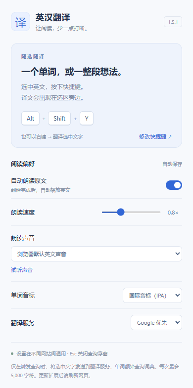

<p align="center"></p>

# 随读译 · Read Aloud Translator

**让阅读，少一点打断。** 选中英文单词、句子或段落，按 **Alt + Shift + Y**，即可在原文旁查看中文译文，并按需朗读英文。

适用于 **Chrome / Edge（Chromium 116+）** · 当前版本 **1.5.1** · **MIT 开源**

[安装使用](#安装和体验) · [下载发布包](https://github.com/whiteCQian/read-aloud-translator/releases) · [问题反馈](https://github.com/whiteCQian/read-aloud-translator/issues) · [隐私政策](PRIVACY_POLICY.md) · [后续规划](#后续规划)

> 本项目基于 [rollingonroad/chromeplugin](https://github.com/rollingonroad/chromeplugin) 修改，感谢原作者 David Wu 的开源工作。保留原项目 MIT 许可与署名。本仓库维护当前衍生版本；原作者的商店上架版本与本仓库发布版本请分别识别。

## 看看它如何工作

### 选中句段，直接阅读完整译文


### 单词音标与发音


### 按自己的节奏朗读



以上图片来自本项目的合成阅读页面及模拟服务响应，用于展示界面，不包含个人查询记录，也不代表在线接口的实时效果。设置图展示的是示例偏好；首次安装默认关闭自动朗读。

## 快速安装：无需编译或自行部署服务器

1. 从 [Releases](https://github.com/whiteCQian/read-aloud-translator/releases) 下载 **read-aloud-translator-1.5.1.zip** 并解压。
2. 在 Chrome 打开 `chrome://extensions/`；Edge 打开 `edge://extensions/`。
3. 开启「开发者模式」→「加载已解压的扩展程序」，选择解压后**直接包含 manifest.json 的文件夹**。
4. 刷新要阅读的网页，选中英文，按 **Alt + Shift + Y**，或右键选择「翻译选中文字」。
5. 点击工具栏扩展图标，设置朗读、语速和音标。

也可以使用 GitHub 的 **Code → Download ZIP** 下载源码，解压后直接加载 `src/`。普通用户不需要 Node.js、npm 或 API 密钥。

**联网说明：** 译文、词典和录音使用第三方在线服务；浏览器朗读的联网需求取决于所选声音。服务可能限流、不可达或改变接口，项目不承诺所有网络环境下可用。遇到接口失败时，可以切换翻译服务后重试。仓库不包含百度代理的后端实现。

## 本版改进

- 用快捷键和右键菜单「翻译选中文字」触发查询，移除双击触发，避免与网页操作冲突。
- 支持句子及段落翻译，拼接全部翻译片段；备用服务按 UTF-8 字节安全分段，每次最多 5,000 个字符。
- 重做查询浮窗：原文、完整译文、复制、重试、朗读与停止；按 Esc 或点击外部关闭。
- 单词独立查询音标和词典发音，不拖慢译文显示；没有音频时也能切换音标。
- 词典录音由扩展自身的后台音频文档播放，不受网页音频加载策略影响；支持多条录音备用及旧版 `//` 音频地址。全部录音失败时会明确提示并自动切换为浏览器朗读；停止或关闭浮窗会取消加载和播放。
- 重做工具栏设置页：自动朗读、0.5～1.5 倍语速、英文声音、DJ / IPA 音标、翻译服务选择。
- 设置保存在扩展自己的 `chrome.storage.local` 中，跨网站通用。
- 新查询取消旧查询，关闭后迟到的结果不会重新打开浮窗。单次请求有 6.5 秒超时，总翻译时间上限为 24 秒。
- 浮窗使用 Shadow DOM 隔离网页样式，支持长内容滚动和较窄窗口；嵌套网页中的选区在顶层网页显示译文。

## 安装和体验

1. 打开 `chrome://extensions/`；Edge 用户打开 `edge://extensions/`。
2. 开启「开发者模式」，点击「加载已解压的扩展程序」，选择本项目的 **`src`** 目录，或构建生成的 **`release`** 目录。
3. 如果此前已加载该目录，点击扩展的刷新按钮。更新或安装后，**刷新准备翻译的网页**。
4. 拖动选中英文，按 **Alt + Shift + Y**，或右键选择「翻译选中文字」。
5. 点击工具栏中的扩展图标调整设置；浮窗右上角的设置按钮也能打开设置页。

快捷键可能被其他扩展或系统占用。设置页会显示实际注册的组合键；点击「修改快捷键」进入浏览器扩展快捷键页面。`Alt + Shift + T` 与浏览器内置操作冲突，因此不作为默认键。

浏览器内部页面（如 `chrome://` / `edge://`）、扩展商店和部分受保护页面不允许注入脚本。普通网页在安装扩展前已打开时也需要刷新。不能连接网页时，扩展图标显示 `!`，悬停可查看提示。本地文件需要在扩展详情中允许访问文件网址。

自动朗读默认关闭。语音由浏览器和操作系统提供，可用声音及是否联网取决于所选语音。英文缩写、带连字符的单词可以查词；句段只显示适用的翻译和朗读操作。

## 服务和数据流

网页脚本只在用户触发查询后向后台发送选中文字，由后台统一请求翻译和词典服务。

- 自动路由：浏览器语言为中文且时区属于配置的中国大陆、香港、澳门或台北时区时，使用「百度代理 → MyMemory」；其他组合使用「Google → MyMemory」。路由是本地偏好判断，不进行地理定位。
- 可以在设置页显式选择 Google 优先或百度代理优先，两条路由都以 MyMemory 为备用。
- 单词音标来自 Free Dictionary API；句子不会调用词典。音标和翻译并行获取。
- 百度代理报告 `BAIDU_PROVIDER_DISABLED` 时，该标签页在当前后台实例内跳过代理，3 小时后可重新尝试；标签页关闭时清理状态。
- 不保存查询历史，不自动发送整页，不在生产日志中输出选中文字、查询 URL 或译文。

具体网络请求、语音和本地存储行为见 [隐私政策](PRIVACY_POLICY.html)。服务地址在 `src/background.js` 中配置，仓库不包含这些服务的后端实现。

## 项目结构

```text
src/
  manifest.json       扩展入口、权限、快捷键和右键菜单权限
  shared.js           默认设置、路由、分段、结果解析、音标转换
  background.js       触发分发、翻译/词典请求、超时和取消
  audio.html          扩展后台音频文档
  audio.js            录音请求、备用地址、播放与资源清理
  content.js          选区读取、隔离浮窗、朗读和交互状态
  popup.html          设置页面
  popup.css           设置页样式
  popup.js            设置保存、声音试听和快捷键说明
  icons/              扩展图标
tests/
  run-tests.js                    离线测试入口
  translation.test.js             真实共享函数测试
  translation_api_config.test.js  真实后台脚本的请求与生命周期测试
  dj_phonetic_convert.test.js     音标转换数据回归
  refactoring.test.js             扩展资源及入口配置检查
  browser.test.js                 真实扩展浏览器交互回归
  audio-browser.test.js           网页禁止音频时的真实解码与播放回归
  fixtures/reading.html           本地阅读测试页
build.js              构建、打包和文档生成
```

## 开发与验证

需要 Node.js 20 或更高版本。扩展运行本身不依赖 Node.js 或前端框架。

```bash
npm install
npm test
npm run build:test
npm run build:zip
npm run gen:html
```

普通构建和离线测试只使用 Node.js 内置模块，因此也可直接运行：

```bash
node tests/run-tests.js
node build.js build
```

浏览器测试需另外准备 Playwright 和支持加载本地扩展的 Chromium 浏览器，详见 [测试说明](tests/README.md)。浏览器自动化使用独立临时配置及模拟服务响应，不修改个人浏览器配置、不写入系统剪贴板，也不会发送测试文本到实际服务。外部服务可用性需要在目标网络中人工体验或单独运行 `npm run bench:cn`，该命令会发起真实请求。

构建产物位于 `release/`，打包名称为 `release.<manifest版本>.zip`。每次改源码后重新构建，再刷新扩展及网页。`clean` 会删除 `release/` 和项目根目录下的 `release.*.zip`，包括历史版本包，使用前注意保留需要的版本。


## 后续规划

以下为候选方向，尚未实现，也不构成交付时间承诺；优先级将结合 Issues 反馈调整。

- **近期：发布与使用体验。** 完善安装截图、常见问题和兼容性记录，建立清晰的版本说明与可下载扩展包。
- **下一阶段：服务与朗读可靠性。** 收集不同网络下的失败情况、可用声音和发音问题，整理成可复现任务交给开发者评估。
- **后续探索：阅读辅助。** 评估更多语言、可访问性及界面偏好；涉及词汇记录或数据导出的功能，先讨论用户授权和数据边界。

## 参与与反馈

使用问题请提交 [Issue](https://github.com/whiteCQian/read-aloud-translator/issues)，写明浏览器版本、扩展版本、操作步骤和实际表现。请使用合成示例，移除账号、密钥、个人设置及敏感网页内容。

贡献流程见 [CONTRIBUTING.md](CONTRIBUTING.md)；版本变化见 [CHANGELOG.md](CHANGELOG.md)。维护工作遵循先验证、后发布，开发修改通过独立分支与 Pull Request 评审。

## 来源与许可

- 原项目：[rollingonroad/chromeplugin](https://github.com/rollingonroad/chromeplugin)，原作者 **David Wu**。
- 本项目在原项目基础上调整选区翻译、句段展示、朗读设置和交互流程；当前行为以本仓库文档和源码为准。
- 使用 [MIT License](LICENSE)，保留 `Copyright (c) 2024 David Wu`。
- 本仓库从当前版本快照开始管理，不导入开发目录中的既有 Git 历史、个人数据或旧版发布包。
